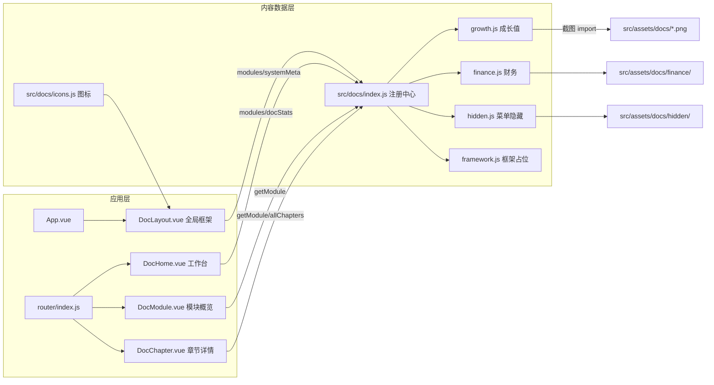

# L0 项目骨架报告

> 生成时间：2026-10-14 | 阶段：L0_SKELETON（第 1 层）| 项目：七七生活后台操作文档系统

## 1. 项目概况

- 形状：**frontend_only**（纯前端静态应用，无后端、无登录态）
- 技术栈：Vue 3 + Vue Router 4（hash 路由）+ Vite 5 + 自绘 CSS（对齐七七生活后台 Element Plus 视觉）
- 页面数：4（工作台、模块概览、章节详情、全局框架布局）
- 功能模块数：4（工作台与统计总览 / 模块与章节浏览 / 章节阅读与截图查看 / 文档内容维护）
- 角色数：1（文档读者·访客，全站只读）
- 文档内容模块：成长值模块（active）、财务（active）、菜单隐藏需求（reference）、全量框架占位（planned）
- 定位：把七七生活后台各模块操作流程整理成「模块 → 章节 → 步骤」三级在线文档，每步含菜单路径、操作说明、注意事项与可点击放大的截图；产物可放任意子目录或以后台 iframe 方式嵌入

## 2. 模块依赖图（Mermaid）

## 3. 角色清单（1 个）

- ROLE_001 文档读者（访客）：全站只读浏览，无登录、无账号体系；统计卡片、模块目录、章节内容对所有访客完全一致（证据：`src/main.js` 无任何鉴权装配、`src/router/index.js` 无路由守卫）

## 4. 数据创建链（需按此顺序操作）

整理模块内容（`src/docs/<模块>.js`）→ 注册模块（`index.js` 的 `modules` 数组）→ 放置截图（`src/assets/docs/`）→ 运行/构建（`一键启动.bat` / `npm run dev` / `npm run build`）→ 工作台统计自动更新（`docStats` 由 `modules` 推导）→ 读者按 模块 → 章节 → 步骤 浏览

## 5. 模块处理顺序（默认全量覆盖）

本会话用户未显式点名模块范围 → `work_mode=full`。项目为 S1 超小项目（4 页面 / 4 功能模块），按 phase-protocol 走 **small_project_fastpath**：EXPLORE/EXTRACT 一步完成六层信息提取（不按批拆分），后续图谱构建（GRAPH_BUILD）与写作（WRITE→INTEGRATE）全流程不跳过。

模块覆盖顺序（core 仅决定先后，不省略任何模块）：MOD_001 工作台与统计总览 → MOD_002 模块与章节浏览 → MOD_003 章节阅读与截图查看 → MOD_004 文档内容维护。

## 6. 证据索引（L0 结论出处）

| 结论 | 证据文件 |
|---|---|
| 纯前端、hash 路由、无鉴权 | `src/main.js`、`src/router/index.js` |
| 模块/统计数据结构 | `src/docs/index.js`（`modules`/`docStats`/`systemMeta`） |
| 步骤字段结构 | `src/docs/growth.js`（`id/title/menu/desc/points/images`） |
| 侧边栏两级导航与折叠 | `src/views/DocLayout.vue` |
| 截图灯箱 | `src/views/DocChapter.vue`（`lightboxImg`） |
| 新增模块两步流程 | `README.md`「如何添加新模块」 |
