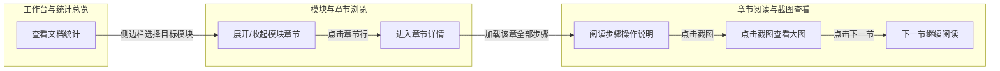
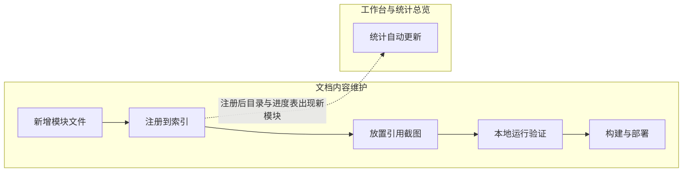
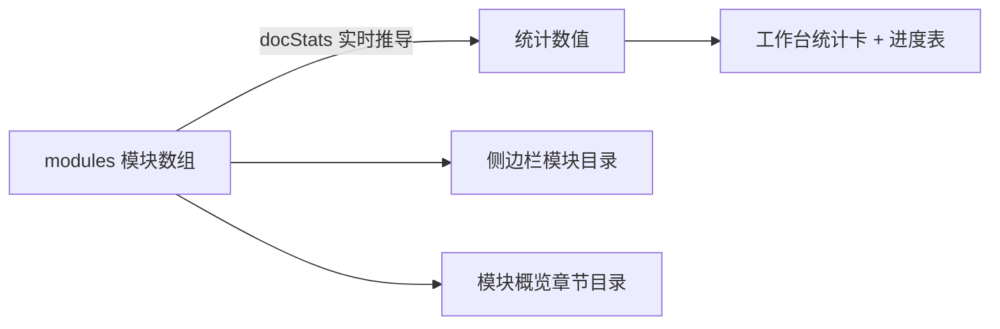

# 附录 D：跨模块操作指南（Snake 全流程链）

> 数据来源：`_kb/graph/_snakes.json` | 每条链配 Mermaid 全景流程图，节点标注所属模块

## D.1 SNAKE_001 读者阅读链（端到端）

**场景**：从打开文档站到按模块 → 章节 → 步骤阅读、看完截图再切到下一节的完整读者动线。跨「工作台与统计总览」「模块与章节浏览」「章节阅读与截图查看」三个模块。

**文字说明**：打开站点看到工作台统计 → 在侧边栏点击目标模块展开章节 → 点击章节行进入详情 → 按顺序阅读每步的菜单路径、操作说明与注意事项 → 需要看细节时点击截图弹出大图 → 读完后点「下一节」直达下一模块的下一章，全程无需返回目录。

## D.2 SNAKE_002 内容维护链（维护者动线）

**场景**：维护者从零新增一个后台模块文档的完整链路。

**文字说明**：复制 growth.js 模板填写内容 → 在 index.js 注册 → 截图放入 src/assets/docs/ 并引用 → 一键启动本地验证（此时工作台统计已自动更新）→ npm run build 产出 dist/ 部署到后台（iframe 或路由合并）。

## D.3 SNAKE_003 统计数据传播链（数据流）

**场景**：一份内容数据如何同时驱动三处界面。

**文字说明**：`src/docs/index.js` 的 modules 数组是唯一数据源，docStats 由其推导（index.js L48-66），同时驱动工作台的四张统计卡与进度表、侧边栏两级目录、模块概览的章节目录。改一处，三处生效。
