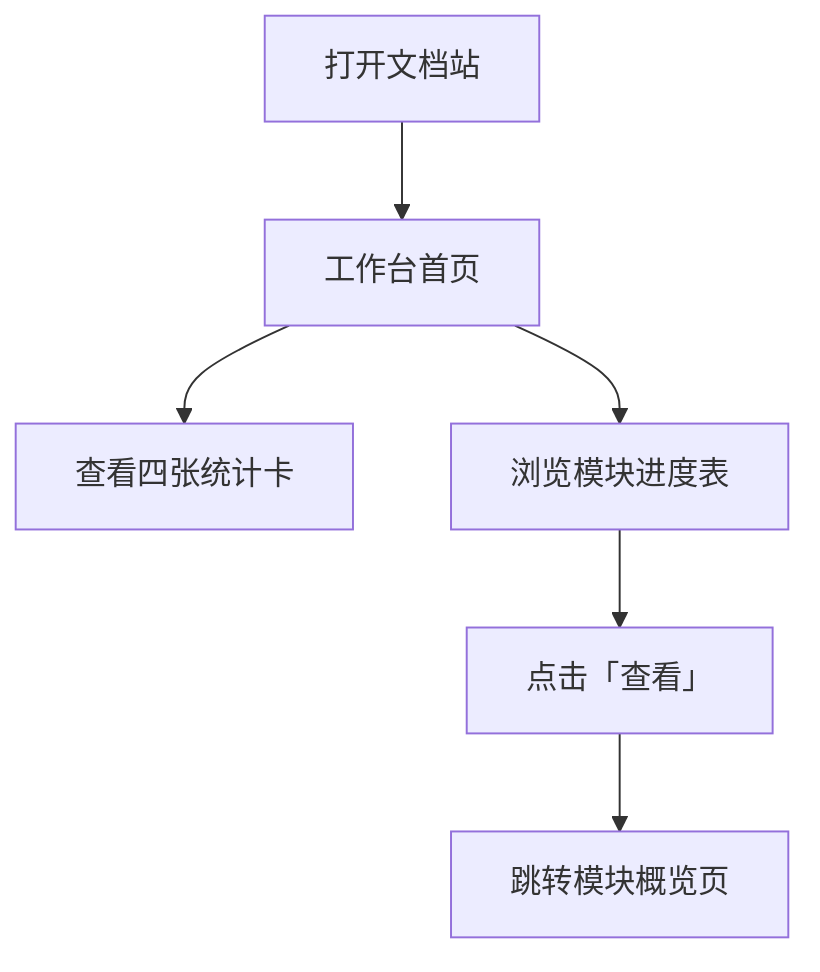

# 1. 工作台与统计总览

> 模块编号：MOD_001 | 页面：工作台（`/`）| 证据：EVD_00001~EVD_00004、EVD_00018

## 1.1 功能介绍

工作台是文档站的首页，回答两个问题：「整套文档有多少内容」和「每个模块整理到什么进度了」。打开站点默认进入本页，侧边栏点击「工作台」也可随时返回。

## 1.2 页面说明

页面自上而下分三个区域：

| 区域 | 内容 |
|---|---|
| 统计卡片区 | 四张卡片：已上线模块、章节总数、操作步骤、操作截图，数字由内容数据实时推导 |
| 模块文档进度表 | 全模块表格：模块 / 状态 / 章节 / 说明 / 操作五列 |
| 关于本文档系统 | 一段说明文字，介绍三级组织方式与「待完善」标记含义 |

## 1.3 操作步骤

### 1.3.1 查看文档统计

1. 打开文档站（或点击侧边栏「工作台」），进入首页。
2. 查看顶部四张统计卡：已上线模块数、章节总数、操作步骤数、操作截图数。
3. 数字随文档内容自动更新，无需手动维护。

### 1.3.2 查看模块文档进度表

1. 在工作台页面中部查看「模块文档进度」表。
2. 每行展示：模块名称、状态标签（已上线 / 参考 / 待完善）、章节数、模块说明。
3. 状态标签说明：「已上线」= 内容完整的正式模块；「参考」= 参考资料（如隐藏的菜单详情）；「待完善」= 框架占位，内容补充中。

### 1.3.3 从进度表跳转模块概览

1. 在进度表找到目标模块行。
2. 点击行内「查看」链接。
3. 页面跳转到该模块的概览页（见第 2 章）。

## 1.4 注意事项

- 统计数字由 `src/docs/index.js` 的 modules 数组实时推导，新增模块并注册后刷新页面即更新。
- 「待完善」模块点击侧边栏行会进入概览页并看到占位提示，不代表数据丢失。
- 操作截图计数的是已引用进步骤的图片总数，未引用的图片不计入。
