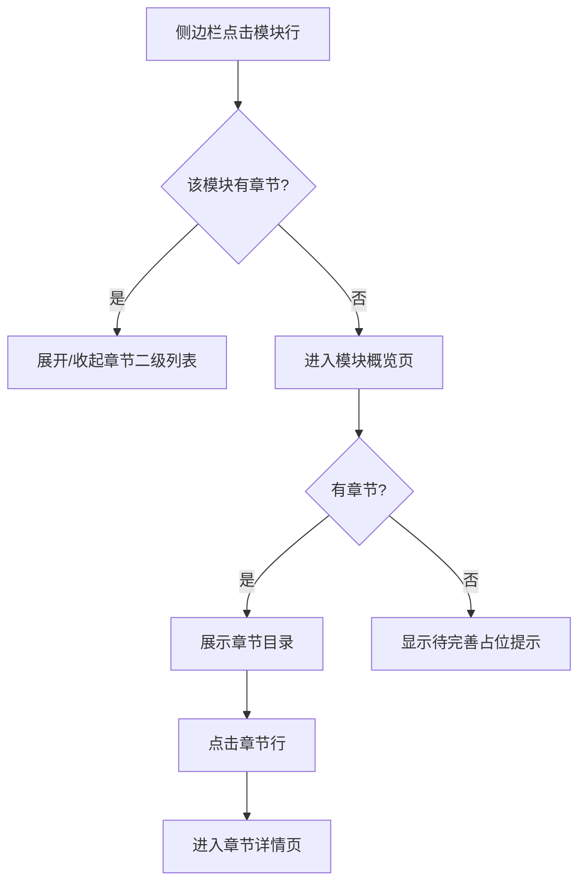

# 2. 模块与章节浏览

> 模块编号：MOD_002 | 页面：全局框架（侧边栏）+ 模块概览（`/doc/:moduleId`）| 证据：EVD_00005~EVD_00010

## 2.1 功能介绍

本模块承载文档站的主导航：左侧边栏按「模块 → 章节」两级组织全量文档，模块概览页汇总单个模块的章节目录。通过侧边栏可以在不同模块间快速切换，通过概览页可以总览一个模块的全部分章。

## 2.2 页面说明

### 2.2.1 侧边栏（全局框架，所有页面可见）

| 区域 | 内容 |
|---|---|
| 品牌区 | 「七」字图标 + 七七生活 / 后台操作文档 |
| 菜单区 | 「工作台」入口 + 「模块分类」两组：模块行（图标、名称、章节数或状态徽章、展开箭头）与章节二级列表 |
| 页脚 | 版本号与更新日期 |

### 2.2.2 模块概览页

| 区域 | 内容 |
|---|---|
| 模块头部 | 模块名称 + 状态徽章（待完善 / 参考资料）+ 一句话简介 |
| 章节目录 | 每章一行：序号、章节标题、简介、步骤数 |
| 空状态 | 无章节时显示「该模块文档待完善」与返回入口 |

## 2.3 操作步骤

### 2.3.1 展开 / 收起模块章节

1. 在侧边栏「模块分类」中点击目标模块行。
2. 该模块的章节二级列表展开（再次点击收起）。
3. 当前所在模块会自动展开，方便定位。

### 2.3.2 一键展开 / 收起全部分类

1. 点击侧边栏「模块分类」标题右侧的「展开」。
2. 全部有章节的模块一次性展开。
3. 点击「收起」则全部折叠。

### 2.3.3 浏览章节目录

1. 通过侧边栏或工作台进度表进入模块概览页。
2. 页面展示该模块的章节目录，每行含序号、标题、简介与步骤数。
3. 通过步骤数可以快速判断哪一章内容最丰富。

### 2.3.4 进入章节详情

1. 在章节目录中点击目标章节行。
2. 页面跳转到该章节的详情页（见第 3 章）。

### 2.3.5 查看待完善模块占位提示

1. 在侧边栏点击带「待完善」徽章的模块行。
2. 概览页显示「该模块文档待完善」提示与「返回文档首页」按钮。
3. 点击按钮返回工作台。

## 2.4 注意事项

- 侧边栏模块行的箭头指示展开状态；无章节的模块（待完善）点击整行直接进入概览。
- 章节顺序即维护者注册时的数组顺序，一般为业务流程顺序。
- 面包屑（工作台 / 模块名 / 章节名）可点击返回上层。
