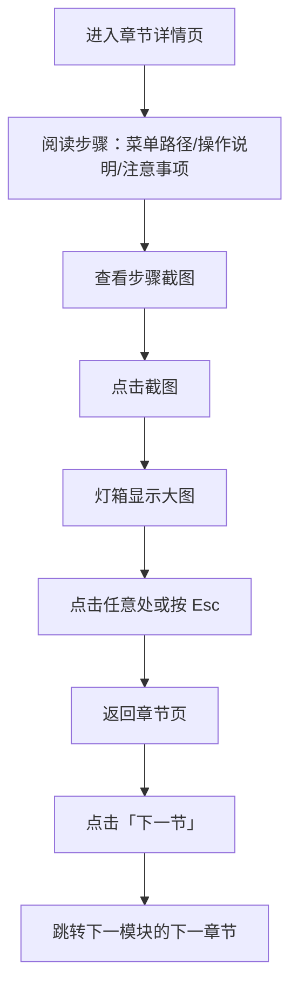

# 3. 章节阅读与截图查看

> 模块编号：MOD_003 | 页面：章节详情（`/doc/:moduleId/:chapterId`）| 证据：EVD_00011~EVD_00015

## 3.1 功能介绍

章节详情是文档的正文页：把一个章节下的全部操作步骤按顺序铺开，每步包含菜单路径、操作说明与注意事项，并配可点击放大的操作截图。页底提供上一节 / 下一节导航，支持跨模块连续阅读，不必回到目录翻找。

## 3.2 页面说明

| 区域 | 内容 |
|---|---|
| 章节头部 | 章节标题 + 「第 N 章」标记 + 章节简介 |
| 步骤内容区 | 每个步骤：序号（章.步）、步骤标题、菜单路径（等宽字体）、操作说明、注意事项列表、截图（含图注） |
| 上下节导航区 | 「上一节」「下一节」按钮，显示相邻章节所属模块与标题 |
| 截图灯箱 | 点击截图后全屏放大，提示「点击任意处或按 Esc 关闭」 |

## 3.3 操作步骤

### 3.3.1 阅读步骤操作说明

1. 通过侧边栏或章节目录进入章节详情页。
2. 页面按顺序展示本章全部步骤。
3. 每步依次阅读：菜单路径（在后台的哪个菜单下操作）→ 操作说明（具体怎么做）→ 注意事项（规则与易错点）。

### 3.3.2 查看步骤操作截图

1. 在步骤内容末尾找到截图，默认限宽展示。
2. 截图下方有图注，格式为「图 章.步-序号 步骤标题」。
3. 需要看细节时进行下一步（点击查看大图）。

### 3.3.3 点击截图查看大图（灯箱）

1. 点击截图任意位置。
2. 页面弹出大图灯箱，显示截图原图。
3. 点击页面任意处或按键盘 Esc 键关闭灯箱，返回章节页。

### 3.3.4 上一节 / 下一节跨模块导航

1. 阅读到章节末尾，查看「上一节 / 下一节」导航区。
2. 点击「下一节」：跳转到全站顺序上的下一个章节（可能属于另一个模块）。
3. 点击「上一节」：返回上一个章节。
4. 导航按钮上会显示目标章节所属模块与标题，跳转目标一目了然。

## 3.4 注意事项

- 截图采用懒加载，滚动到位置时才加载，弱网环境下稍候即可显示。
- 图注编号按章内步骤顺序编排，正文引用以图注为准。
- 「下一节」的顺序为全站章节扁平化顺序（模块注册顺序 → 章内顺序），跨模块时按钮会标注模块名。
- 章节不存在时会显示「章节不存在」提示，可返回文档首页。
