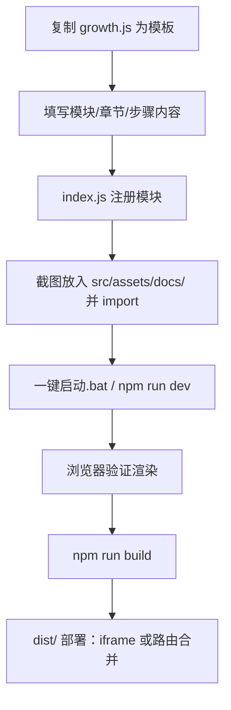

# 4. 文档内容维护（维护者）

> 模块编号：MOD_004 | 对象：源码与命令行（无界面区域）| 证据：EVD_00019、EVD_00020、EVD_00021、EVD_00022
>
> 本章面向文档维护者，操作对象是项目源码与本地命令行，普通读者无需阅读。

## 4.1 功能介绍

整套后台文档都往这个系统里加，新增一个模块只有两步：新建模块文件 + 注册模块。截图放置、本地运行、构建部署均有固定位置与命令。本章说明完整维护链路。

## 4.2 内容数据结构

文档内容全部在 `src/docs/` 目录，按「模块 → 章节 → 步骤」三级组织：

| 层级 | 载体 | 关键字段 |
|---|---|---|
| 模块 | `src/docs/<模块>.js` 的 default 导出 | id（唯一）、name、summary、status（active/reference/planned）、icon、chapters |
| 章节 | chapters 数组元素 | id（模块内唯一）、title、summary、steps |
| 步骤 | steps 数组元素 | id、title、menu（菜单路径）、desc（操作说明）、points（注意事项，可省略）、images（截图，可省略） |

## 4.3 操作步骤

### 4.3.1 新增文档模块文件

1. 复制 `src/docs/growth.js` 为 `src/docs/<你的模块>.js`（如 `order.js`）。
2. 修改文件开头的默认导出：设置模块 id、name、summary、status。
3. 在 chapters 数组中按「章节 → 步骤」结构填充内容，每步写清 menu / desc / points。

### 4.3.2 注册模块到索引

1. 打开 `src/docs/index.js`。
2. 在文件顶部 `import <模块> from './<模块>'`。
3. 将其加入 `modules` 数组（顺序即侧边栏与首页展示顺序）。
4. 若 `framework.js` 中存在同名占位项，删除该占位（或按 OVERRIDDEN_IDS 机制过滤）。
5. 保存后刷新页面即可看到新模块，无需改动其他任何代码。

### 4.3.3 放置并引用操作截图

1. 将截图复制到 `src/assets/docs/`（可按模块建子目录，如 `finance/`、`hidden/`）。
2. 在模块文件顶部 `import img01 from '@/assets/docs/图片名.png'`。
3. 在对应步骤的 `images: [img01]` 中引用。

### 4.3.4 本地运行文档站

1. 方式一（推荐）：双击项目根目录的「一键启动.bat」——服务已在运行则直接打开浏览器；首次运行自动安装依赖。
2. 方式二：命令行执行 `npm install`（首次）后 `npm run dev`。
3. 浏览器访问 http://localhost:5173 。
4. 停止服务：关闭黑色命令行窗口或按 Ctrl+C 。

### 4.3.5 构建与部署

1. 执行 `npm run build`，产物在 `dist/` 目录。
2. 部署方式二选一：
   - iframe 嵌入：把 `dist/` 放到后台静态资源目录（如 `/docs/`），在后台页面嵌入 `<iframe src="/docs/index.html" style="width:100%;height:100%;border:none;"></iframe>`；
   - 路由合并：将文档路由并入后台路由体系（页签 / 侧边栏配置在 `src/views/DocLayout.vue`）。
3. 如需与后台统一账号体系（读取后台登录态），在 `src/main.js` 中接入后台的 token 获取逻辑。

## 4.4 注意事项

- 模块 id 与章节 id 会进入 URL，必须唯一且建议使用有意义的英文。
- `status` 三态：active（已上线）/ reference（参考资料）/ planned（待完善，显示占位）。
- 图标从 `src/docs/icons.js` 的内置图标表选择（home/growth/finance/lock/set/audit/grid/user/news/map/login/video/bag/box/layers/store/bell/live/module）。
- 工作台统计（模块数/章节数/步骤数/截图数）由注册数据自动推导，无需手工维护。
- 纯静态无后端，构建产物可放任意子路径；hash 路由无需服务器改写配置。
