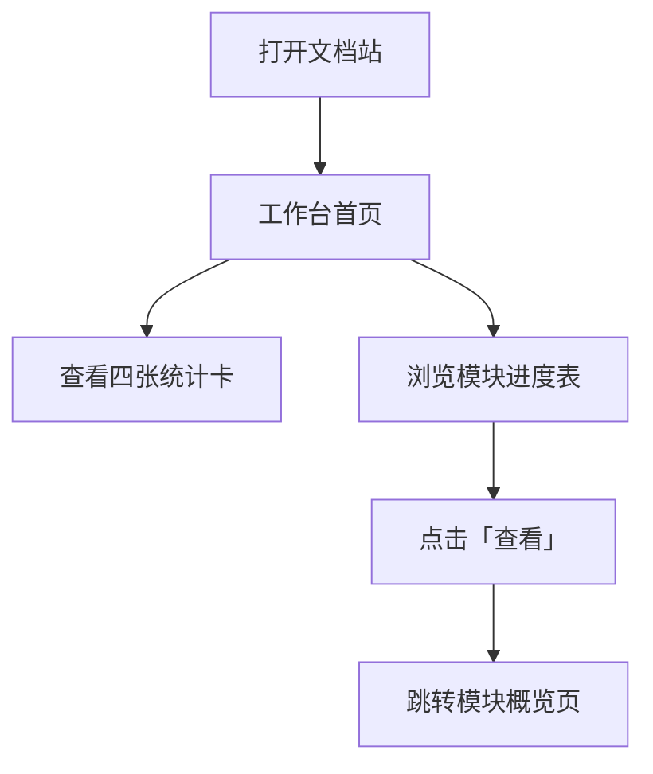
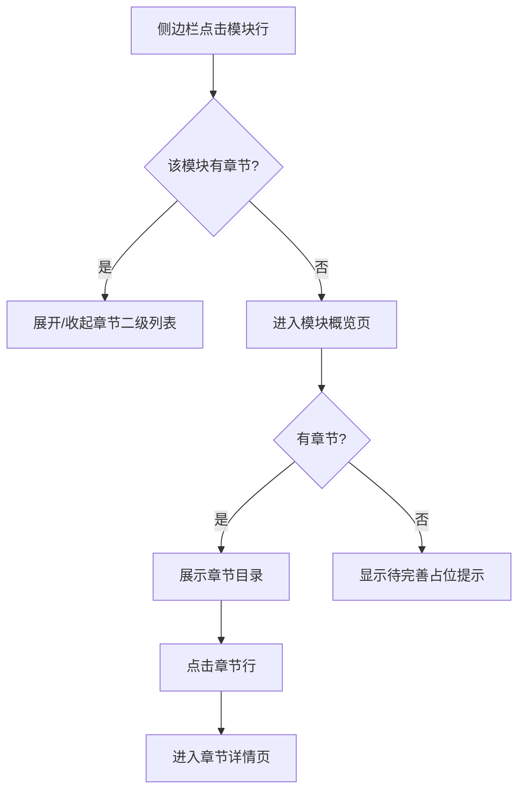
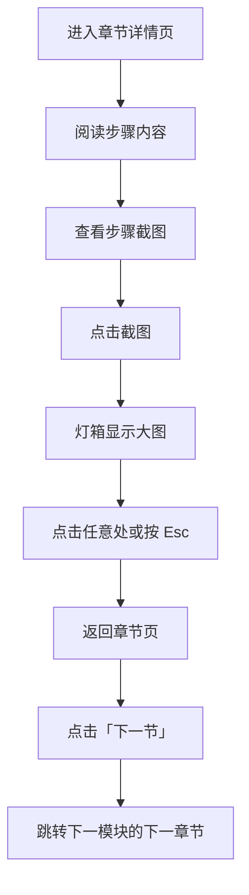

# 七七生活后台操作文档系统 操作手册（用户版）

---

## 文档信息

- 版本: v1.0.0
- 更新日期: 2026-10-14
- 文档类型: 用户操作手册
- 适用范围: 文档读者（访客）、文档维护者
- 覆盖范围: 覆盖项目全部功能模块（100%）：工作台与统计总览、模块与章节浏览、章节阅读与截图查看、文档内容维护
- 生成方式: ManualGen v6.3 全流程自动生成（L0 骨架 → 图谱构建 → 模块写作 → 合并终审），每段文字可追溯至源码证据（附录 E）

> **查看流程图的方法**：本文档中的业务流程图使用 Mermaid 语法绘制。
> 看不到图形时：VS Code 安装 "Markdown Preview Mermaid Support" 扩展；Typora 直接打开；或上传 GitHub 自动渲染。所有流程图下方均配有文字说明，不依赖图形也能理解操作路径。

---

## 名词释义

| 术语/状态 | 含义 | 说明 |
|---|---|---|
| 模块 | 一个后台业务领域的文档集合 | 如成长值模块、财务；侧边栏一级分类 |
| 章节 | 模块下的一个操作主题 | 侧边栏二级分类；概览页目录行 |
| 步骤 | 一个原子操作 | 含菜单路径、操作说明、注意事项、截图 |
| 已上线（active） | 内容完整的正式模块 | 统计卡计入「已上线模块」 |
| 参考（reference） | 参考资料性质 | 如菜单隐藏需求 |
| 待完善（planned） | 框架占位，内容补充中 | 侧边栏带徽章，概览页显示占位提示 |
| 灯箱 | 截图点击放大层 | 点击任意处或按 Esc 关闭 |
| 接力棒/图谱 | ManualGen 内部产物 | 位于 `.agent/harness/`，非交付物 |

---

## 目录

**第一篇 快速入门**
1. 系统简介
2. 界面导览
3. 通用操作规则

**第二篇 核心功能**
4. 工作台与统计总览
5. 模块与章节浏览
6. 章节阅读与截图查看

**第三篇 权限与角色对照**
7. 角色权限矩阵

**第四篇 全流程业务闭环**
8. 读者阅读链（端到端）
9. 统计数据传播链

**第五篇 常见问题**
10. 日常操作答疑

**第六篇 维护者指南**
11. 文档内容维护

**第七篇 附录**
- 附录 B：角色权限总览
- 附录 C：AI 自主决策记录
- 附录 D：跨模块操作指南（Snake 全流程链）
- 附录 E：证据索引
- 附录 F：未覆盖模块/功能清单

---

# 第一篇 快速入门

## 1. 系统简介

七七生活后台操作文档系统把后台各模块的操作流程整理为可在线浏览的文档站，按「模块 → 章节 → 步骤」三级组织：每步包含菜单路径（在后台哪个菜单下操作）、操作说明（具体怎么做）、注意事项（规则与易错点）与可点击放大的操作截图。系统为纯前端静态应用，无需登录，打开即用。

## 2. 界面导览

界面分左右两栏：

| 区域 | 内容 |
|---|---|
| 左侧边栏 | 品牌区（七七生活 · 后台操作文档）、「工作台」入口、「模块分类」两级导航（模块行可展开/收起章节）、版本页脚 |
| 右侧内容区 | 顶部面包屑（工作台 / 模块名 / 章节名）+ 主内容区（随页面变化） |

三个核心页面：**工作台**（统计与进度总览）、**模块概览**（单模块章节目录）、**章节详情**（步骤正文）。

## 3. 通用操作规则

- 侧边栏点击模块行：有章节 → 展开/收起；无章节（待完善）→ 进入概览页。
- 所在模块在侧边栏自动展开，方便定位。
- 面包屑可点击返回上层。
- 截图懒加载：滚动到位置时加载，稍候即可显示。
- 章节末尾「上一节 / 下一节」可跨模块连续阅读。

---

# 第二篇 核心功能

## 4. 工作台与统计总览

### 4.1 功能介绍

文档站首页，回答「整套文档有多少内容」与「每个模块整理到什么进度」。

### 4.2 页面说明

- **统计卡片区**：已上线模块、章节总数、操作步骤、操作截图四张卡，数字由内容数据实时推导。
- **模块进度表**：模块 / 状态（已上线·参考·待完善）/ 章节 / 说明 / 操作（查看）五列。
- **关于本文档系统**：三级组织方式与「待完善」标记含义说明。

### 4.3 操作步骤

1. 打开文档站（或点击侧边栏「工作台」）进入首页。
2. 查看四张统计卡的数值。
3. 在进度表中浏览各模块状态与章节数。
4. 点击目标行「查看」跳转模块概览页。

### 4.4 注意事项

- 统计由 `src/docs/index.js` 的 modules 数组实时推导，新增模块注册后刷新即更新。
- 截图计数仅统计已引用进步骤的图片。

## 5. 模块与章节浏览

### 5.1 功能介绍

文档站主导航：侧边栏「模块 → 章节」两级分类 + 模块概览页章节目录。

### 5.2 操作步骤

1. **展开/收起模块章节**：点击侧边栏模块行，展开该模块章节列表；再次点击收起。
2. **一键展开/收起全部**：点击「模块分类」右侧的「展开」或「收起」。
3. **浏览章节目录**：进入模块概览页，查看每章序号、标题、简介与步骤数。
4. **进入章节详情**：点击章节目录行。
5. **待完善模块**：点击带徽章的模块行，概览页显示占位提示，可点「返回文档首页」。

### 5.3 注意事项

- 章节顺序即维护者注册顺序，一般为业务流程顺序。
- 无章节模块点击整行直接进入概览。

## 6. 章节阅读与截图查看

### 6.1 功能介绍

章节正文页：按步骤展示菜单路径、操作说明、注意事项与截图，支持灯箱大图与跨模块连续阅读。

### 6.2 操作步骤

1. **阅读步骤**：进入章节详情页，按顺序阅读每步的菜单路径 → 操作说明 → 注意事项。
2. **查看截图**：步骤末尾截图限宽展示，下方图注格式「图 章.步-序号 步骤标题」。
3. **查看大图**：点击截图弹出灯箱；点击任意处或按 Esc 关闭。
4. **跨模块导航**：章节末尾点击「下一节」跳转全站顺序的下一章节（按钮标注所属模块与标题）；「上一节」返回。

### 6.3 注意事项

- 截图懒加载，弱网稍候即显示。
- 图注编号按章内步骤顺序编排。
- 章节不存在时显示「章节不存在」提示。

---

# 第三篇 权限与角色对照

## 7. 角色权限矩阵

文档站无登录、无账号体系，所有访客看到的内容完全一致。

| 功能 | 访客权限 |
|---|---|
| 统计查看、目录浏览、章节阅读、截图查看、章节导航（13 项 read/query 功能） | ✅ 全部可执行 |
| 新增模块、注册、放截图、本地运行、构建部署（5 项维护者操作） | ⚪ 维护者源码操作，不面向访客（见第 11 章） |

完整矩阵见**附录 B**。

---

# 第四篇 全流程业务闭环

## 8. 读者阅读链（端到端）

打开站点看到工作台统计 → 侧边栏点击目标模块展开章节 → 点击章节行进入详情 → 按顺序阅读每步 → 点击截图看大图 → 点「下一节」直达下一模块下一章。全景流程图见**附录 D.1**。

## 9. 统计数据传播链

`src/docs/index.js` 的 modules 数组是唯一数据源：docStats 由其推导，同时驱动工作台统计卡与进度表、侧边栏目录、模块概览章节目录——改一处，三处生效。数据流图见**附录 D.3**。

---

# 第五篇 常见问题

## 10. 日常操作答疑

| 问题现象 | 可能原因 | 解决办法 |
|---|---|---|
| 截图位置空白/裂图 | 懒加载未完成或网络慢 | 稍候片刻；滚动到截图位置触发加载 |
| 页面打不开 | 本地服务未启动 | 双击「一键启动.bat」或命令行 `npm run dev` 后访问 localhost:5173 |
| 点击模块行没反应 | 该模块无章节（待完善） | 再次点击整行进入概览查看占位提示 |
| 统计数字不变 | 浏览器缓存 | 硬刷新（Ctrl+F5） |
| 「章节不存在」提示 | URL 中的模块/章节 ID 无效 | 从侧边栏或工作台重新进入 |
| 一键启动报 npm 不是内部命令 | 系统未安装 Node.js | 安装 Node.js LTS 后重试 |
| 截图看不清细节 | 默认限宽展示 | 点击截图弹出灯箱看原图 |

---

# 第六篇 维护者指南

## 11. 文档内容维护

> 面向文档维护者，操作对象是源码与命令行。

### 11.1 新增一个模块（两步）

1. **新建模块文件**：复制 `src/docs/growth.js` 为 `src/docs/<你的模块>.js`，修改 default 导出（id/name/summary/status）并按「章节 → 步骤」填充内容（steps 字段：id/title/menu/desc/points/images）。
2. **注册模块**：在 `src/docs/index.js` 中 import 并加入 modules 数组；删除 framework.js 中同名占位项。保存刷新即生效。

### 11.2 截图放置

截图复制到 `src/assets/docs/`（可按模块建子目录），模块文件顶部 `import img01 from '@/assets/docs/图片名.png'` 后在 `images: [img01]` 引用。

### 11.3 运行与部署

- 本地运行：双击「一键启动.bat」（自动装依赖）或 `npm run dev`，访问 http://localhost:5173 。
- 构建部署：`npm run build` 产物在 `dist/`；iframe 嵌入后台静态目录，或路由合并（配置在 `src/views/DocLayout.vue`）。

### 11.4 注意事项

- 模块/章节 ID 会进入 URL，必须唯一。
- status 三态：active / reference / planned。
- 图标从 `src/docs/icons.js` 内置表选择。
- 详细规则以 README「如何添加新模块」为准。

---

# 第七篇 附录

- **附录 B：角色权限总览** —— `output_user_manual/_appendix/appendix-B-permission-matrix.md`
- **附录 C：AI 自主决策记录** —— `output_user_manual/_appendix/appendix-C-AI-auto-decisions.md`
- **附录 D：跨模块操作指南（Snake 全流程链）** —— `output_user_manual/_appendix/appendix-D-snake-flows.md`
- **附录 E：证据索引（24 条，含文件与行号）** —— `output_user_manual/_appendix/appendix-E-evidence-index.md`
- **附录 F：未覆盖模块/功能清单** —— `output_user_manual/_appendix/appendix-F-uncalled-modules.md`

---

*本手册由 ManualGen v6.3 生成：81 图谱节点 / 114 关系三元组 / 24 条证据 / 3 条跨模块链，全量覆盖 4 个功能模块。内部产物位于 `.agent/harness/`（非交付物）。*
